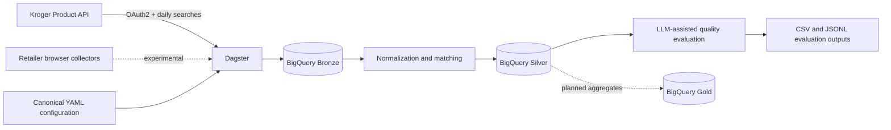

# Grocery Price Pipeline

A Dagster-orchestrated data pipeline for collecting, validating, and modeling
daily grocery product and price data across U.S. store locations.

The pipeline currently uses the Kroger Product API as its primary source. It
searches a canonical grocery basket across stores in Los Angeles, Chicago, New
York City, Dallas, and Seattle, stores append-only snapshots in BigQuery, and
promotes validated records through configuration-driven quality rules.

The repository also contains experimental browser-based collectors for H-E-B,
Meijer, Walmart, Vons, Winn-Dixie, and Sprouts.

## Why this project exists

Comparing grocery prices is harder than collecting a number from a product
page. Retail catalogs vary by location, search results include adjacent or
irrelevant products, and the same concept may appear under inconsistent names,
categories, sizes, and availability rules.

This project treats price collection as a data-quality problem:

- collect repeatable daily snapshots;
- retain raw source data for auditability;
- define grocery concepts in version-controlled configuration;
- reject category and description mismatches before analysis;
- measure false positives instead of assuming search results are correct; and
- keep ingestion, validation, and analytical layers separate.

## Architecture



### Medallion layers

| Layer | Status | Purpose |
|---|---|---|
| **Bronze** | Implemented | Append-only API and scraper snapshots, including raw source payloads and ingestion metadata |
| **Silver** | Implemented | Deduplicated, normalized products that pass category, token, and exclusion rules |
| **Gold** | Planned | Analytics-ready price indices, geographic comparisons, and time-series aggregates |

## Implemented workflow

The scheduled Kroger job materializes two Dagster assets in sequence.

### 1. Bronze ingestion

`exploration_kroger_products_daily`:

- authenticates with Kroger using OAuth2 client credentials;
- loads canonical search terms from YAML;
- queries each term at five U.S. store locations;
- captures product identity, category, price, size, availability metadata, and
  the raw API response;
- writes rows to
  `grocery-pipe-line.grocery_bronze.exploration_kroger_products`;
- flushes BigQuery inserts in batches of 500; and
- retries failed Dagster runs up to five times.

The job is scheduled for **06:00 UTC each day**.

### 2. Silver transformation

`silver_exploration_kroger_products` builds and executes a BigQuery
`MERGE` that:

- maps each search term to a canonical category;
- normalizes product descriptions and category strings;
- applies term-specific inclusion and exclusion rules;
- deduplicates by snapshot date, location, search term, and product ID; and
- writes only records that pass all configured quality checks.

This keeps the matching policy out of ad hoc analysis code and makes changes
reviewable in Git.

### 3. Quality evaluation

`grocery_pipeline/scripts/eval_silver_false_positives.py` samples distinct
silver records and asks an LLM to classify each product match as:

- `PASS`: a valid match for the canonical search term;
- `FAIL`: an adjacent or incorrect product; or
- `UNCLEAR`: insufficient evidence for a reliable decision.

The evaluator writes CSV and JSONL outputs so false-positive patterns can be
reviewed and converted into deterministic matching rules. LLM output is a QA
signal, not the final source of truth.

## Configuration-driven matching

Three YAML files define the canonical product model.

### `canonical_search_terms.yaml`

Groups broad and specific search terms into grocery categories.

```yaml
search_terms:
  produce:
    breadth:
      - apples
      - bananas
    drilldown:
      - gala apples
      - granny smith apples
```

### `canonical_categories.yaml`

Defines the expected retailer category and related metadata for each canonical
bucket.

### `canonical_search_term_rules.yaml`

Defines term-level matching behavior.

| Strategy | Behavior |
|---|---|
| `all_tokens` | Every token in the search term must appear |
| `any_of` | At least one configured token must appear |
| `require_any_of` | At least one required token must appear |
| `require_all_of` | Every required token must appear |
| `none_of` | Configured exclusion tokens must not appear |

Example:

```yaml
rules:
  frozen broccoli:
    strategy: all_tokens
    none_of:
      - meal
      - alfredo
      - cheese
      - stuffed
      - medley
```

A product reaches silver only when its category matches, its inclusion strategy
passes, and no exclusion token is present.

## Data coverage

### Kroger API locations

| Market | ZIP code | Kroger location ID |
|---|---:|---|
| Los Angeles | 90012 | `70300022` |
| Chicago | 60007 | `53100541` |
| New York City | 10001 | `542FC805` |
| Dallas | 75204 | `03500529` |
| Seattle | 98039 | `70500808` |

### Experimental retailer collectors

Dagster assets and sensor configuration also exist for:

- H-E-B
- Meijer
- Walmart
- Vons
- Winn-Dixie
- Sprouts

These collectors depend on a separate local Playwright proof-of-concept
repository and configured browser sessions. They are not yet a self-contained
part of this repository.

## BigQuery model

### Bronze

`grocery_bronze.exploration_kroger_products`

Representative fields:

- `snapshot_date`
- `search_term`
- `location_id`
- `product_id`
- `upc`
- `brand`
- `description`
- `categories`
- `price`
- `size`
- `raw`
- `ingestion_ts`

### Silver

`grocery_silver.exploration_kroger_products`

Silver retains the source fields and adds quality metadata such as:

- canonical category and bucket;
- normalized descriptions and categories;
- term tokens;
- match-condition flags; and
- the final `kept` decision.

The table is partitioned by snapshot date and clustered for common
location/product access patterns.

### Example analysis

```sql
SELECT
  snapshot_date,
  location_id,
  search_term,
  COUNT(DISTINCT product_id) AS matching_products,
  APPROX_QUANTILES(price, 4)[OFFSET(2)] AS median_price
FROM `grocery-pipe-line.grocery_silver.exploration_kroger_products`
WHERE price IS NOT NULL
GROUP BY snapshot_date, location_id, search_term
ORDER BY snapshot_date DESC, search_term, location_id;
```

## Repository layout

```text
grocery-price-pipeline/
├── grocery_pipeline/
│   ├── assets/
│   │   ├── bronze/          # API and browser-based ingestion
│   │   ├── silver/          # BigQuery normalization and matching
│   │   └── gold/            # Planned analytical assets
│   ├── config/              # Canonical terms, categories, and rules
│   ├── jobs/                # Dagster asset jobs
│   ├── resources/           # BigQuery resource
│   ├── schedules/           # Daily Kroger schedule
│   ├── sensors/             # Per-retailer sensor definitions
│   └── scripts/             # Data-quality evaluation utilities
├── warehouse/
│   ├── bronze/              # Bronze DDL
│   ├── silver/              # Silver DDL
│   └── migrations/          # Dataset initialization
├── setup.cfg
└── README.md
```

## Running the project

### Prerequisites

- Python 3.10 through 3.13
- a Google Cloud project with BigQuery enabled;
- Application Default Credentials or a service account with BigQuery access;
- Kroger API client credentials; and
- an OpenAI API key only when running the optional LLM evaluator.

### Installation

```bash
git clone https://github.com/ivanrsalazar/grocery-price-pipeline.git
cd grocery-price-pipeline

python3 -m venv .venv
source .venv/bin/activate

pip install -e .
pip install dagster-webserver google-cloud-bigquery requests pyyaml openai
```

### Environment variables

```bash
export KROGER_CLIENT_ID="your-client-id"
export KROGER_CLIENT_SECRET="your-client-secret"
export GOOGLE_APPLICATION_CREDENTIALS="/path/to/service-account.json"

# Optional: required only for the evaluation script
export OPENAI_API_KEY="your-openai-api-key"
```

Never commit credentials or service-account files.

### Create the warehouse

Review the project IDs in the SQL files and Python configuration, then execute
the DDL under `warehouse/` in BigQuery. The current deployment uses the
`grocery-pipe-line` project ID.

### Start Dagster

On the configured deployment host:

```bash
dagster dev -m grocery_pipeline.definitions
```

Open the Dagster UI, materialize
`bronze_kroger_products_daily_job`, and enable
`bronze_kroger_products_daily_schedule` when the credentials and tables are
ready.

> **Local-development note:** the current `Definitions` module also imports
> experimental scraper assets from `~/lab/retail_scraper_poc/src`. Without
> that external repository, those imports must be disabled or replaced before
> starting the complete Dagster code location.

### Run the false-positive evaluator

```bash
python grocery_pipeline/scripts/eval_silver_false_positives.py --help
```

Use the available flags to select search terms, sample limits, and the target
BigQuery table. Review generated outputs before translating findings into YAML
rules.

## Current limitations

- Gold-layer price indices and aggregates are not implemented yet.
- Several deployment paths and the BigQuery project ID are currently
  environment-specific.
- Browser-based retailer collectors rely on a separate local repository and
  manually managed browser sessions.
- Automated tests and CI are not yet included.
- Product-size normalization is not yet sufficient for unit-price comparisons.
- API availability and retailer catalog behavior can change independently of
  this pipeline.

## Roadmap

- materialize gold price-history and geographic-comparison tables;
- normalize package sizes and calculate comparable unit prices;
- make project IDs and paths environment-driven;
- integrate the retailer collectors without external source-path dependencies;
- add data-quality tests, CI, and pipeline observability;
- monitor BigQuery cost and freshness; and
- publish analytical dashboards over gold-layer data.

## Responsible use

Respect retailer terms, rate limits, and applicable API policies. The browser
collectors are research tooling and should not be used to bypass access
controls. Collected data should be stored and shared in accordance with each
source's terms.
