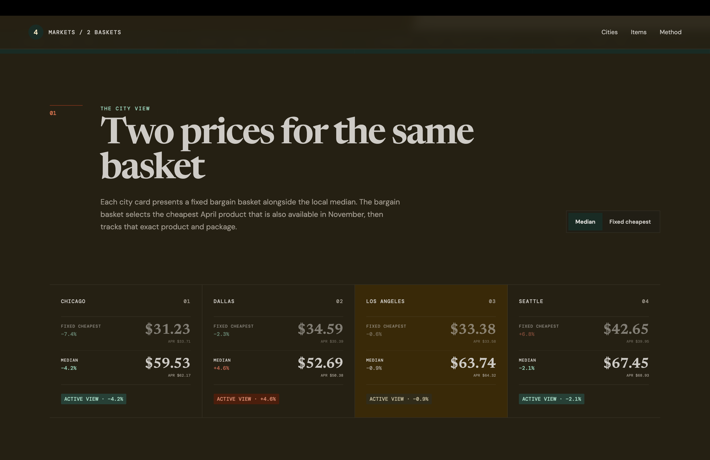
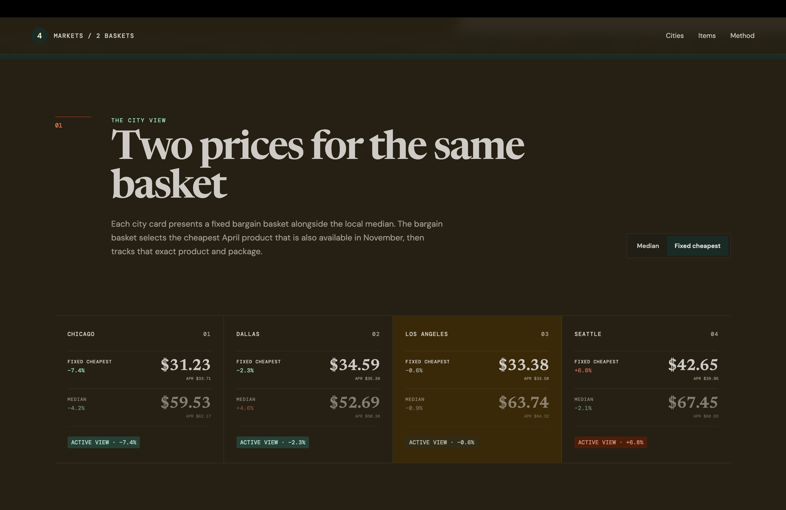
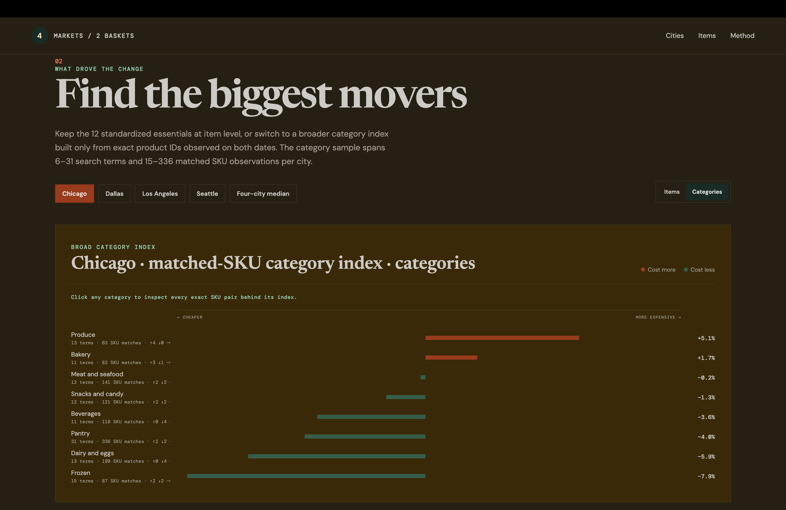
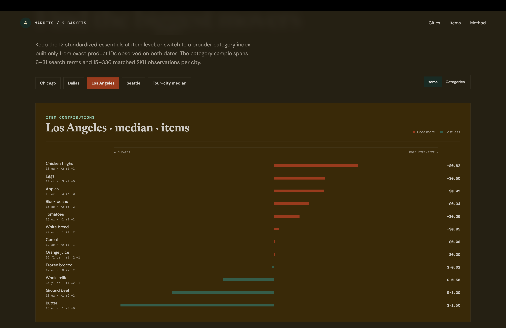
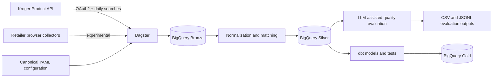

# Grocery Price Pipeline

A Dagster-orchestrated data pipeline for collecting, validating, and modeling
daily grocery product and price data across U.S. store locations.

The pipeline currently uses the Kroger Product API as its primary source. It
searches a canonical grocery basket across stores in Los Angeles, Chicago, New
York City, Dallas, and Seattle, stores append-only snapshots in BigQuery, and
promotes validated records through configuration-driven quality rules.

The repository also contains experimental browser-based collectors for H-E-B,
Meijer, Walmart, Vons, Winn-Dixie, and Sprouts.

## Portfolio highlights

This repository demonstrates hands-on ownership of a modern analytics workflow:
API ingestion, BigQuery warehouse design, modular dbt transformations, data
quality testing, orchestration, documentation, and a decision-ready analytical
product.

| Area | Implementation |
|---|---|
| **dbt modeling** | 23 staging, intermediate, fact, and mart models targeting BigQuery |
| **Data quality** | 58 generic and singular tests, plus source-freshness thresholds |
| **Dimensional inputs** | Version-controlled seeds for locations and basket definitions |
| **Documentation** | Model and column descriptions, lineage metadata, and a dashboard exposure |
| **Optimization** | Date partitioning and clustering on high-use BigQuery models |
| **Orchestration** | Dagster runs source freshness and `dbt build` after the silver asset succeeds |
| **Analytics product** | Interactive four-city dashboard backed by tested gold-layer marts |

The dbt work is not a standalone tutorial project: its models are part of the
scheduled pipeline, consume the curated silver feed, and produce the tables
used by the portfolio dashboard.

## Dashboard preview

The analytical layer supports two deliberately different basket methods: a
standardized 12-item basket showing both market median and fixed-cheapest
prices, and a broader category index restricted to exact SKU matches across
the two comparison dates.

| Median basket comparison | Fixed-cheapest basket comparison |
|---|---|
|  |  |

| Matched-SKU category movers | Standardized item movers |
|---|---|
|  |  |

The category bars are auditable in the local dashboard: selecting one opens
the exact product IDs, package sizes, shelf prices, and normalized unit prices
that support the result.

## Why this project exists

Comparing grocery prices is harder than collecting a number from a product
page. Retail catalogs vary by location, search results include adjacent or
irrelevant products, and the same concept may appear under inconsistent names,
categories, sizes, and availability rules.

This project treats price collection as a data-quality problem:

- collect repeatable daily snapshots;
- retain raw source data for auditability;
- define grocery concepts in version-controlled configuration;
- reject category and description mismatches before analysis;
- measure false positives instead of assuming search results are correct; and
- keep ingestion, validation, and analytical layers separate.

## Architecture



### Medallion layers

| Layer | Status | Purpose |
|---|---|---|
| **Bronze** | Implemented | Append-only API and scraper snapshots, including raw source payloads and ingestion metadata |
| **Silver** | Implemented | Deduplicated, normalized products that pass category, token, and exclusion rules |
| **Gold** | Implemented | dbt-tested grocery baskets, price indices, geographic comparisons, and data-quality marts |

## Implemented workflow

The scheduled Kroger job materializes three Dagster assets in sequence:
bronze ingestion, silver validation, and the dbt-powered gold build.

### 1. Bronze ingestion

`exploration_kroger_products_daily`:

- authenticates with Kroger using OAuth2 client credentials;
- loads canonical search terms from YAML;
- queries each term at five U.S. store locations;
- captures product identity, category, price, size, availability metadata, and
  the raw API response;
- writes rows to
  `grocery-pipe-line.grocery_bronze.exploration_kroger_products`;
- flushes BigQuery inserts in batches of 500; and
- retries failed Dagster runs up to five times.

The job is scheduled for **06:00 UTC each day**.

### 2. Silver transformation

`silver_exploration_kroger_products` builds and executes a BigQuery
`MERGE` that:

- maps each search term to a canonical category;
- normalizes product descriptions and category strings;
- applies term-specific inclusion and exclusion rules;
- deduplicates by snapshot date, location, search term, and product ID; and
- writes only records that pass all configured quality checks.

This keeps the matching policy out of ad hoc analysis code and makes changes
reviewable in Git.

### 3. Quality evaluation

`grocery_pipeline/scripts/eval_silver_false_positives.py` samples distinct
silver records and asks an LLM to classify each product match as:

- `PASS`: a valid match for the canonical search term;
- `FAIL`: an adjacent or incorrect product; or
- `UNCLEAR`: insufficient evidence for a reliable decision.

The evaluator writes CSV and JSONL outputs so false-positive patterns can be
reviewed and converted into deterministic matching rules. LLM output is a QA
signal, not the final source of truth.

### 4. Gold analytics with dbt

The [`dbt/`](dbt/) project builds and tests two complementary grocery baskets:

- `canonical_essentials`: twelve canonical items priced using each market's
  median matched product price; and
- `matched_sku`: eight identical UPCs available across every active market on
  the baseline and current comparison dates.

Gold marts include daily basket totals, city affordability rankings, price
indices, item-level price changes, an April-to-latest comparison, unit-price
parsing, and daily data-quality metrics. The canonical basket also has a
fixed-quantity mart that reports both the cheapest eligible option and the
market median for all twelve items. A separate broad category index uses only
exact product IDs observed on both snapshots, compares normalized unit prices,
and reports the matched-SKU sample behind each category. Dagster runs `dbt source
freshness` and `dbt build` after the silver asset succeeds.

#### Model design

The project uses a layered DAG rather than putting business logic directly in
dashboard queries.

| dbt layer | Responsibility | Examples |
|---|---|---|
| **Sources and staging** | Declare BigQuery sources, deduplicate observations, and create stable keys | `stg_kroger_products`, `stg_locations`, `stg_basket_items` |
| **Intermediate** | Parse units, normalize package quantities, identify comparable products, and calculate market-level item statistics | `int_unit_prices`, `int_comparable_cheapest_items_daily`, `int_standardized_item_prices_daily` |
| **Facts** | Preserve item-level grain for basket and standardized-price observations | `fct_grocery_basket_daily`, `fct_standardized_basket_daily` |
| **Marts** | Produce basket totals, indices, period comparisons, movers, audit tables, and data-quality reporting | `mart_period_comparison`, `mart_category_price_movers`, `mart_category_price_support` |

Notable modeling decisions include:

- normalizing ounces, pounds, gallons, quarts, pints, fluid ounces, and counts
  before comparing prices;
- excluding ambiguous multipacks from standardized calculations;
- tracking the same product ID and package quantity for the fixed-cheapest
  basket;
- restricting the broad category index to exact product IDs observed on both
  April 7 and November 12;
- giving search terms equal weight so categories with more configured searches
  do not automatically dominate; and
- partitioning and clustering larger BigQuery relations for their expected
  access patterns.

#### Testing, freshness, and documentation

The project currently defines **58 dbt data tests**. In addition to generic
`not_null`, `unique`, `relationships`, and `accepted_values` tests, singular
tests assert that:

- the four active markets are present in the latest snapshot;
- canonical baskets are complete before they reach reporting;
- standardized item prices are positive; and
- fixed-cheapest comparisons retain the same product and package quantity.

The silver source has freshness thresholds of 36 hours for warnings and 72
hours for errors. Model and column descriptions live in
[`dbt/models/schema.yml`](dbt/models/schema.yml), source contracts and
freshness rules in [`dbt/models/sources.yml`](dbt/models/sources.yml), and the
dashboard lineage is declared as a dbt exposure in
[`dbt/models/exposures.yml`](dbt/models/exposures.yml).

#### Production-style orchestration

The Dagster [`gold_dbt_models`](grocery_pipeline/assets/gold/dbt_gold.py) asset
depends on the silver transformation. It executes `dbt source freshness`
before `dbt build`, streams dbt logs into the Dagster run, and fails the asset
if either command returns a non-zero exit code. This makes model execution and
tests part of the pipeline contract rather than a manual validation step.

## Configuration-driven matching

Three YAML files define the canonical product model.

### `canonical_search_terms.yaml`

Groups broad and specific search terms into grocery categories.

```yaml
search_terms:
  produce:
    breadth:
      - apples
      - bananas
    drilldown:
      - gala apples
      - granny smith apples
```

### `canonical_categories.yaml`

Defines the expected retailer category and related metadata for each canonical
bucket.

### `canonical_search_term_rules.yaml`

Defines term-level matching behavior.

| Strategy | Behavior |
|---|---|
| `all_tokens` | Every token in the search term must appear |
| `any_of` | At least one configured token must appear |
| `require_any_of` | At least one required token must appear |
| `require_all_of` | Every required token must appear |
| `none_of` | Configured exclusion tokens must not appear |

Example:

```yaml
rules:
  frozen broccoli:
    strategy: all_tokens
    none_of:
      - meal
      - alfredo
      - cheese
      - stuffed
      - medley
```

A product reaches silver only when its category matches, its inclusion strategy
passes, and no exclusion token is present.

## Data coverage

### Kroger API locations

| Market | ZIP code | Kroger location ID |
|---|---:|---|
| Los Angeles | 90012 | `70300022` |
| Chicago | 60007 | `53100541` |
| New York City | 10001 | `542FC805` |
| Dallas | 75204 | `03500529` |
| Seattle | 98039 | `70500808` |

### Experimental retailer collectors

Dagster assets and sensor configuration also exist for:

- H-E-B
- Meijer
- Walmart
- Vons
- Winn-Dixie
- Sprouts

These collectors depend on a separate local Playwright proof-of-concept
repository and configured browser sessions. They are not yet a self-contained
part of this repository.

## BigQuery model

### Bronze

`grocery_bronze.exploration_kroger_products`

Representative fields:

- `snapshot_date`
- `search_term`
- `location_id`
- `product_id`
- `upc`
- `brand`
- `description`
- `categories`
- `price`
- `size`
- `raw`
- `ingestion_ts`

### Silver

`grocery_silver.exploration_kroger_products`

Silver retains the source fields and adds quality metadata such as:

- canonical category and bucket;
- normalized descriptions and categories;
- term tokens;
- match-condition flags; and
- the final `kept` decision.

The table is partitioned by snapshot date and clustered for common
location/product access patterns.

### Example analysis

```sql
SELECT
  snapshot_date,
  location_id,
  search_term,
  COUNT(DISTINCT product_id) AS matching_products,
  APPROX_QUANTILES(price, 4)[OFFSET(2)] AS median_price
FROM `grocery-pipe-line.grocery_silver.exploration_kroger_products`
WHERE price IS NOT NULL
GROUP BY snapshot_date, location_id, search_term
ORDER BY snapshot_date DESC, search_term, location_id;
```

## Repository layout

```text
grocery-price-pipeline/
├── grocery_pipeline/
│   ├── assets/
│   │   ├── bronze/          # API and browser-based ingestion
│   │   ├── silver/          # BigQuery normalization and matching
│   │   └── gold/            # Dagster-managed dbt gold build
│   ├── config/              # Canonical terms, categories, and rules
│   ├── jobs/                # Dagster asset jobs
│   ├── resources/           # BigQuery resource
│   ├── schedules/           # Daily Kroger schedule
│   ├── sensors/             # Per-retailer sensor definitions
│   └── scripts/             # Data-quality evaluation utilities
├── warehouse/
│   ├── bronze/              # Bronze DDL
│   ├── silver/              # Silver DDL
│   └── migrations/          # Dataset initialization
├── dbt/                     # Models, seeds, tests, analyses, and docs
├── docs/                    # Portfolio dashboard screenshots
├── sites/                   # Local static analytical dashboard
├── setup.cfg
└── README.md
```

## Running the project

### Prerequisites

- Python 3.10 through 3.13
- a Google Cloud project with BigQuery enabled;
- Application Default Credentials or a service account with BigQuery access;
- Kroger API client credentials; and
- an OpenAI API key only when running the optional LLM evaluator.

### Installation

```bash
git clone https://github.com/ivanrsalazar/grocery-price-pipeline.git
cd grocery-price-pipeline

python3 -m venv .venv
source .venv/bin/activate

pip install -e .
pip install dagster-webserver google-cloud-bigquery requests pyyaml openai
```

### Environment variables

```bash
export KROGER_CLIENT_ID="your-client-id"
export KROGER_CLIENT_SECRET="your-client-secret"
export GOOGLE_APPLICATION_CREDENTIALS="/path/to/service-account.json"

# Optional: required only for the evaluation script
export OPENAI_API_KEY="your-openai-api-key"
```

Never commit credentials or service-account files.

### Create the warehouse

Review the project IDs in the SQL files and Python configuration, then execute
the DDL under `warehouse/` in BigQuery. The current deployment uses the
`grocery-pipe-line` project ID.

### Start Dagster on macOS

For the Kroger-only local deployment, use the self-contained definitions module:

```bash
uv venv --python python3.13 .venv
uv pip install --python .venv/bin/python -e .

./scripts/kroger_launch_agent.sh install
```

The LaunchAgent keeps Dagster alive after the terminal closes and restarts it
if it exits. The service loads the Kroger credentials from `~/.zshrc`, uses local
Application Default Credentials for BigQuery, persists Dagster state under
`.dagster/`, and opens the UI at <http://127.0.0.1:3000>. The daily schedule is
enabled by default and runs at 06:00 UTC.

Service commands:

```bash
# Verify the background service
./scripts/kroger_launch_agent.sh status

# Follow logs
./scripts/kroger_launch_agent.sh logs

# Run one ingestion immediately in the foreground
./scripts/kroger_service.sh run-once

# Gracefully stop the background service
./scripts/kroger_launch_agent.sh stop

# Load and start it again
./scripts/kroger_launch_agent.sh start

# Stop it and move the installed plist to Trash
./scripts/kroger_launch_agent.sh uninstall
```

The Mac must be running and awake at schedule time. A run missed while the Mac
is powered off is not automatically backfilled; use `run-once` after startup
when needed.

> **Local-development note:** the current `Definitions` module also imports
> experimental scraper assets from `~/lab/retail_scraper_poc/src`. Without
> compatible external scraper modules, use `grocery_pipeline.definitions_kroger`
> as shown above rather than the complete code location.

### Run the false-positive evaluator

```bash
python grocery_pipeline/scripts/eval_silver_false_positives.py --help
```

Use the available flags to select search terms, sample limits, and the target
BigQuery table. Review generated outputs before translating findings into YAML
rules.

### Build and inspect the gold layer

```bash
.venv/bin/dbt source freshness --project-dir dbt --profiles-dir dbt
.venv/bin/dbt build --project-dir dbt --profiles-dir dbt
.venv/bin/dbt docs generate --project-dir dbt --profiles-dir dbt
.venv/bin/dbt docs serve --project-dir dbt --profiles-dir dbt --port 8080
```

See [`dbt/README.md`](dbt/README.md) for basket methodology and caveats.

### View the portfolio dashboard

The private, published dashboard tells the four-city April 7 versus November
12 story with the standardized 12-item basket, fixed-SKU comparisons, and the
broader matched-SKU category index shown in the screenshots above:

<https://four-city-grocery-basket.lemonyfort3.chatgpt.site>

Its buildless source is under `sites/four-city-grocery-basket/`.

To serve the same dashboard locally in the background, replace `8085` with any
available port and use these commands:

```bash
# Start on a custom port
./sites/four-city-grocery-basket/dashboard.sh start 8085

# Check whether it is running
./sites/four-city-grocery-basket/dashboard.sh status 8085

# Stop the process
./sites/four-city-grocery-basket/dashboard.sh stop 8085
```

Then open <http://127.0.0.1:8085>. See
[`sites/four-city-grocery-basket/README.md`](sites/four-city-grocery-basket/README.md)
for local-network and stop instructions.

## Current limitations

- Only four configured markets currently return reliable product data; the
  inactive New York location is excluded from gold coverage tests.
- Browser-based retailer collectors rely on a separate local repository and
  manually managed browser sessions.
- CI is not yet configured to run the Python and dbt test suites automatically.
- Unit-price parsing covers common ounce, pound, liquid-volume, and count
  formats but not every retailer size string or multipack convention.
- API availability and retailer catalog behavior can change independently of
  this pipeline.

## Roadmap

- expand package-size and multipack normalization;
- make project IDs and paths environment-driven;
- integrate the retailer collectors without external source-path dependencies;
- add data-quality tests, CI, and pipeline observability;
- monitor BigQuery cost and freshness; and
- automate dashboard data refreshes from the documented gold marts.

## Responsible use

Respect retailer terms, rate limits, and applicable API policies. The browser
collectors are research tooling and should not be used to bypass access
controls. Collected data should be stored and shared in accordance with each
source's terms.
